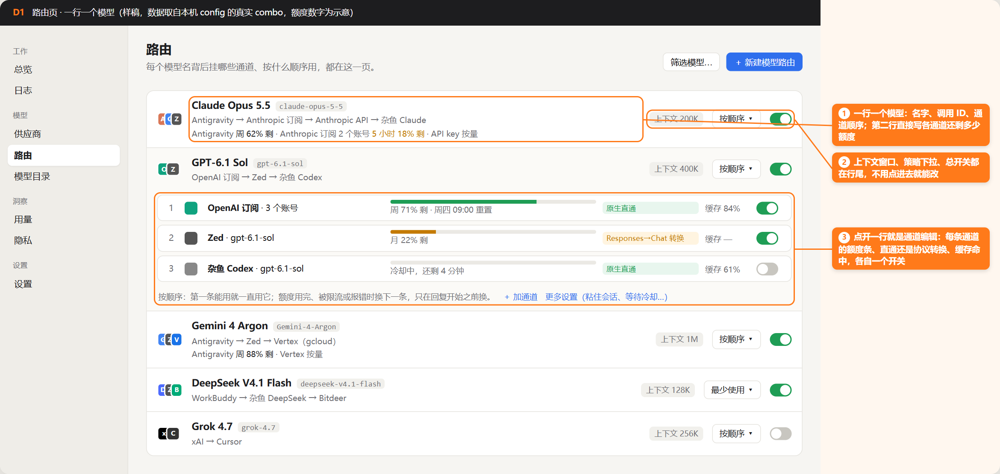
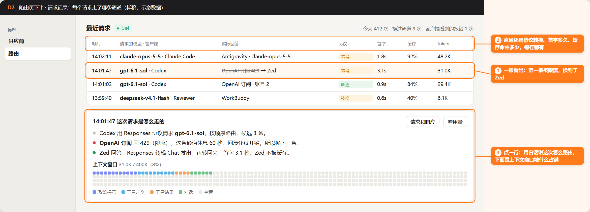
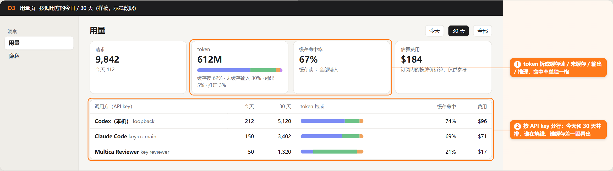
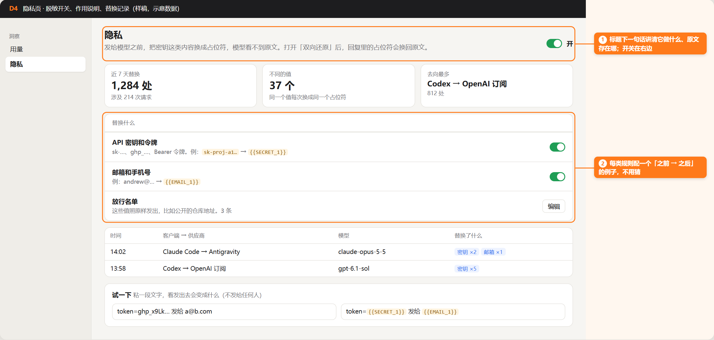

# 驾驶舱设计稿：照 Magpie 拆出来的四页

票：PX-1447（母票 PX-1446）。只做设计，不改 `gui/` 和 `src/`。子票 1（路由页）、2（隐私页）照这份实现。

样稿图在同目录：`d1.png`～`d4.png`，源文件 `mockups.html`（`notes.js` 画橙色标注）。图里的模型名和通道顺序取自本机 `~/.opencodex/config.json` 的真实 combo；额度、次数、费用是示意数字。

## 怎么读的 Magpie

Magpie 的界面跑在桌面 webview 里，3267 端口只提供 API、打不开页面，所以没有 Magpie 实机截图，结构全部来自源码：

- 路由：`internal/gui/assets/plugins/routing/client.js`（`groupRow`、`routeTag`、`groupQuota`、`reqRow`、`renderLog`、`MODES` / `GROUP_HINT`）
- 上下文窗口：`context.js`（`ctxCard`：400 格网格 + 七类内容）
- 用量：`plugins/usage/page.js`（`PERIODS`、按 key 的卡片）
- 脱敏：`plugins/redact/page.js`（7/30 天汇总、按请求 / 按值两种列表、Try it）
- 设置：`index.html` 的 `.row.pref` 行 + `settingshints.js`

## D1 路由页：一行一个模型

Magpie 的「路由组」一行（`groupRow`）由下面这些部分组成，照搬结构：

| 元素 | Magpie 怎么做 | OpenCodex 数据来源 | 状态 |
|---|---|---|---|
| 叠起来的通道图标 | `stackIcon(groupIcons(g))`，同时是拖动排序的把手 | combo.targets[].provider → `gui/src/provider-icons.ts` | 有 |
| 名字 + 调用 ID | `<b>name</b><code>group/id</code>` | combo 键名；显示名用 `model-display.ts` | 有 |
| 通道顺序行 | 成员用「 → 」（按顺序）或「 · 」（其他策略）连起来 | combo.targets 顺序 | 有 |
| 额度说明行 | `groupQuota`：每个供应商一行「名字，N 个账号：周 x% · 5 小时 y%」 | `/api/quota-pool`、Codex 额度缓存、`src/quota/window-mapping.ts` | 部分：只有订阅类有窗口；API key 类写「按量」 |
| 上下文窗口 | Magpie 放在请求卡片里，没放行上 | provider model 的 `contextWindow`（`src/types/config.ts:328`） | 有；combo 取各通道最小值 |
| 策略下拉 | `routeTag`：行内按钮，点开菜单选中即保存，每项带一句说明 | combo.strategy：failover / round-robin / random / least-used / reset-window / jev | 有 |
| 总开关 | `lib-switch`：关掉保留配置，只是不再提供给客户端 | combo 的 disabled 模型（`comboDisabledModelId`） | 有 |
| 标签 | 规则数、几条被关、首字超时 | stickyLimit、cooldown、lastResort | 有 |
| 编辑 | 整行可点，原地展开成编辑器 | — | 纯前端 |

展开后的通道编辑（D1 标注 3），每条通道一行：序号、图标、名字和账号数、额度条（剩余 + 重置时间）、直通 / 转换标签、缓存命中、单独开关。下面一句话解释当前策略，然后是「加通道」「更多设置」。粘住会话、等待冷却、effort 这些低频项收进「更多设置」。

策略说明（照 Magpie `GROUP_HINT` 的写法，对应 OpenCodex 六种策略）：

- failover → 按顺序：第一条能用就一直用它；额度用完、被限流或报错时换下一条，只在回复开始之前换。
- round-robin → 轮流：每次请求换下一条通道，分摊额度。
- random → 随机：每次随机挑一条能用的。
- least-used → 最少使用：最近用得最少的通道先上。
- reset-window → 先用快重置的：额度快重置的账号先用，免得重置时白白浪费。
- jev → 智能判断：先让一个小模型看请求，再决定发给哪条、用多大的推理强度。

## D2 请求记录：每个请求走了哪条通道

Magpie 路由页上半是实时请求列表（`reqRow`），点一行在下方讲「这次请求怎么路由的」（`renderLog`），再下面是上下文窗口卡片（`ctxCard`）。

| 元素 | OpenCodex 数据来源 | 状态 |
|---|---|---|
| 时间、请求的模型、客户端 | usage 日志 `PersistedUsageEntry`：timestamp、requestedModel / requestedAlias、surface、apiKeyId | 有 |
| 实际回答，失败的通道划掉 | provider / servedModel；`attempts[]` | 有 |
| 直通 / 转换 | `protocolTrace.mode`：native / translated / legacy-bridge / blocked | 有（旧行没有，显示「—」） |
| 首字、缓存、token | 延迟字段、`cacheReadInputTokens` | 有 |
| 白话讲路由过程 | `src/routing/trace.ts`（排除原因、健康、额度证据）、`/api/routing-analytics` | 部分：证据有，缺「原因码 → 中文句子」映射 |
| 请求和响应正文 | — | 缺：OpenCodex 不留请求体 |
| 上下文窗口占用 | 输入 token ÷ contextWindow | 部分：按「系统提示 / 工具 / 工具结果 / 对话」拆分没有来源，第一版只画总占用 |
| 实时出现 | `/api/logs` | 部分：没有推送，先用 `visibility-poll.ts` 轮询 |

## D3 用量页：值得借的三点

1. 时间段固定为「今天 / 7 天 / 30 天 / 全部」（Magpie `PERIODS`），OpenCodex 已有 `usage-time-range.ts`。
2. token 拆成缓存读 / 未缓存输入 / 输出 / 推理四段堆叠条，缓存命中率单独一格，算法「缓存读 ÷ 全部输入（含缓存写）」，和 Magpie 一致。数据：`src/usage/summary.ts` 的 `cacheReadInputTokens`、`cacheCreationInputTokens`。
3. 按调用方（API key）分行，今天和 30 天两列并排。数据：usage 的 `apiKeyId`（`summary.ts:1060` 已支持过滤），本机 loopback 单列一行。

费用一律写「估算」，并注明订阅内的请求按牌价折算。

## D4 隐私页

Magpie 脱敏页的顺序：一句话讲原理和原文存在哪 → 7/30 天汇总（替换次数、不同值个数、去向最多的「客户端 → 供应商」）→ 替换规则 → 按请求的记录 → 「试一下」。

| 元素 | OpenCodex 数据来源 | 状态 |
|---|---|---|
| 总开关 | `privacy.enabled`（默认关） | 有 |
| 双向还原、工具参数也还原 | `restoreResponses`、`restoreToolArguments` | 有；放在总开关下面两行，各配一句风险说明 |
| 汇总三格 | `/api/privacy/stats`：totals、flows、daily | 有 |
| 按请求记录 | stats.requests（最近 200 条） | 有 |
| 放行名单 | `/api/privacy/allow-values` | 有 |
| 试一下 | `/api/privacy/test` | 有 |
| 按类别开关（密钥 / 邮箱 / 手机号） | — | 缺：只有一个总开关；样稿里的分类开关第一版做成只读说明 |
| 「按值」视图 | placeholderHashes | 部分：只有哈希，可按占位符分组，不能显示原值 |
| 账号邮箱遮挡 | `privacy.maskEmails` | 有；属于显示设置，放设置页，不和请求脱敏混在一起 |

## 设置页的写法规则

Magpie 的设置好懂，是因为每一行都按同一个格式写。子票 1、2 和以后的设置项都照这个写：

1. 一行一项：左边名字 + 一句说明，右边控件。名字用名词短语，不写成问句。
2. 说明写打开以后用户能看到什么结果，不写实现。例：「关掉窗口一分钟后释放约 100 MB；代理和任务照常运行」。
3. 有代价就在同一句里说。例：「关掉的话，WSL 里的客户端不再显示」。
4. 数值项写单位和默认值；能举例就举例（隐私页的「之前 → 之后」）。
5. 按用户想做的事分组，不按代码模块分。
6. 长说明默认收起，鼠标停 0.45 秒或键盘聚焦时浮出（`settingshints.js`）；屏幕阅读器仍能读到。
7. 改了没保存，在控件旁边写「未保存」。
8. 关掉的功能不消失：在原位置写「已在 X 里关闭」，并给一个打开按钮（Magpie `rt-goff`）。
9. 所有文案走 i18n，每种语言都补（`gui/AGENTS.md`）。

## 组件清单

| 组件 | 用在 | 说明 |
|---|---|---|
| ModelRouteRow | D1 | 图标叠、名字 + ID、顺序行、额度行、上下文、策略下拉、开关 |
| ChannelRow | D1 展开 | 序号、图标、额度条、协议标签、缓存、开关；可拖动排序 |
| StrategyMenu | D1 | 下拉，每项一句说明，选中即保存 |
| QuotaBar | D1 | 绿 > 50%，黄 20–50%，红 < 20% 或冷却中 |
| ProtocolTag | D1、D2 | 原生直通（绿）/ 转换（黄，悬停显示 A→B）/ 被拦（红） |
| RequestRow + RouteStory | D2 | 请求行；点开后的白话步骤（灰 = 起点，红 = 失败，绿 = 回答） |
| ContextBar | D2 | 第一版只画总占用；拆分数据到位后换网格 |
| StatTile、TokenStack | D3、D4 | 大数字 + 小注；四段堆叠条 |
| PrefRow | 设置、D4 | 名字 + 说明 + 控件 |

## 缺口清单（后端没有）

1. 上下文窗口按内容拆分（系统提示 / 工具 / 工具结果 / 对话）：没有来源。第一版只显示总占用。
2. 请求和响应正文：不保留。D2 的「请求和响应」按钮第一版不做。
3. 路由原因的白话句子：`trace.ts` 有原因码，前端要写映射并补齐各语言。
4. 实时推送：没有 SSE / WebSocket，先轮询。
5. API key 类通道的额度：没有窗口，只能写「按量」或显示近 30 天花费。
6. 隐私按类别开关：后端只有总开关。
7. combo 的上下文窗口：没有单独字段，取各通道最小值并注明。

## 需要 Andrew 定的

- 路由页新开，还是替换现在的 Combos 页？默认：替换 Combos（同一份数据），旧页留一个版本作「高级」入口后删。
- 请求记录放路由页下半（Magpie 的做法），还是并入日志页？默认：放路由页下半，日志页不动。

